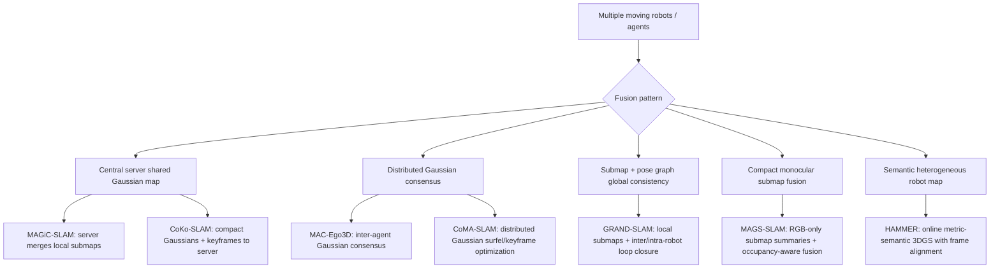

# Multi-Robot Online Gaussian SLAM Implementations

## Executive Summary

The corrected target exists, but it is much narrower than the earlier single-robot/multi-camera 3DGS SLAM landscape. The best matches are systems where multiple moving agents produce observations or local Gaussian submaps, then align, merge, optimize, or reach consensus over a shared Gaussian map. The strongest auditable public-code candidates are **MAGiC-SLAM**, **MAC-Ego3D**, **CoKo-SLAM**, and **CoMA-SLAM**. **MAGiC-SLAM** is the most mature public multi-agent RGB-D Gaussian SLAM implementation; **CoKo-SLAM** is a newer public system focused on compact keyframe/submap communication; **MAC-Ego3D** is public MIT code for real-time collaborative ego-motion and Gaussian-map reconstruction; **CoMA-SLAM** is public implementation-looking code for distributed multi-agent Gaussian-surfel SLAM, but lacks a top-level license.

Several highly relevant systems are paper-only or not yet auditable. **HAMMER** is especially important for Mosaic because it targets heterogeneous robot teams, online server-based metric-semantic Gaussian Splatting, and shared maps usable for open-vocabulary semantic queries, but its project page still marks code as coming later. **GRAND-SLAM** is a strong paper-only large-scale RGB-D multi-agent Gaussian SLAM system with outdoor six-agent evidence. **MAGS-SLAM** is the cleanest claimed RGB-only / monocular multi-agent 3DGS SLAM direction, but code/data are promised after acceptance. **MANG-SLAM** is bibliographically real but source and architecture details remain low-confidence.

For Mosaic, do not import any of these into core. Treat the open implementations as optional research backends behind process/container boundaries and extract architecture contracts: per-agent observation streams, local Gaussian submaps, shared-map snapshots, inter-agent alignment constraints, compact map-update messages, provenance, communication metrics, and regression artifacts.

## Target Definition Used

A system counts as target-class when it has all of the following:

1. multiple independently moving robots, agents, or devices;
2. online or incremental operation, not only offline reconstruction;
3. Gaussian Splatting, Gaussian surfels, Gaussian submaps, or a closely related Gaussian map representation;
4. a shared/fused map mechanism: centralized map merge, distributed consensus, pose-graph/submap fusion, Gaussian-level fusion, or global frame alignment;
5. evidence of RGB, RGB-D, stereo, or RGB+LiDAR/image-based robot observations.

Static multi-view 3DGS training, stereo-only SLAM, single-robot multi-camera rigs, and independent per-agent maps do not satisfy the target gate unless they include shared/fused map semantics.

## Main Candidate Catalogue

| Rank | System | Target status | Open implementation | Sensor modality | Fusion architecture | Key benchmark / evidence | Mosaic relevance |
|---:|---|---|---|---|---|---|---|
| 1 | **MAGiC-SLAM** | Confirmed target-class | Public GitHub; MIT text with third-party 3DGS caveat; mature research code | RGB-D multi-agent streams | Agent/server: local submaps, server-side loop detection, pose graph optimization, global map merge | ReplicaMultiagent and AriaMultiagent; reported Replica ATE avg 0.27 cm, peak GPU memory 1.12 GiB, submap disk 54 MB, global merge 167 s | Best immediate open-source backend reference for shared-map lifecycle and multi-agent contracts |
| 2 | **MAC-Ego3D** | Target-class by function; near-target if title must say SLAM | Public GitHub; MIT; Dockerfile/configs/scripts visible | RGB-D, Multi-Agent Replica and 7-Scenes | Distributed / consensus: intra-agent Gaussian consensus and asynchronous inter-agent Gaussian consensus into global model | Multi-Agent Replica avg ATE 0.14 cm; PSNR 40.04 dB; 0.02 s tracking and 0.05 s mapping per frame in extracted tables | Best public reference for Gaussian consensus and collaborative ego-motion + reconstruction |
| 3 | **CoKo-SLAM** | Confirmed target-class | Public GitHub; MIT text with third-party 3DGS caveat; young and dependency hygiene issues | RGB-D; rendered-depth and camera-depth modes | Central server merges/optimizes local maps; compacted Gaussians/keyframes; loop closure without initial guess | Claims 85-95% lower transmitted data; ReplicaMultiagent and AriaMultiagent configs | Strongest open reference for compact submap/keyframe communication and bandwidth-aware fusion |
| 4 | **CoMA-SLAM** | Confirmed relevant Gaussian-map system; 2D Gaussian surfels | Public GitHub, but no top-level license found | Modality not fully visible in fetched sources; repo uses ReplicaMultiagent/AriaMultiagent configs | Distributed multi-agent Gaussian SLAM; 2D Gaussian surfels; distributed keyframe optimization; submap-centric updates; intra/inter-loop closure | AAAI page claims 99.8% lower communication bandwidth and improved pose/rendering/geometric consistency | Useful for distributed, low-communication Gaussian-map contracts; license unresolved blocks reuse |
| 5 | **HAMMER** | Confirmed target-class | No public code found; project page says code coming | Heterogeneous robot/device streams; image + local SLAM poses; semantic/open-vocabulary mapping | Server-based online shared metric-semantic 3DGS; global frame alignment without prior relative poses | Replica avg PSNR 37.28 dB; online update 15-38 ms/frame; 30-35 Mbps/device; real Aria + ground robot deployments | Best paper reference for heterogeneous robots and agent-facing semantic Gaussian maps |
| 6 | **GRAND-SLAM** | Confirmed target-class | No public code found | RGB-D multi-agent, large-scale/outdoor | Local submap optimization plus inter/intra-robot loop closure and pose-graph optimization | Multiagent Replica avg ATE 0.25 cm, PSNR 41.35; Kimera-Multi Outdoor 6 agents over 1.85 km, avg ATE 4.99 m | Best evidence for large-scale multi-agent/outdoor Gaussian SLAM evaluation |
| 7 | **MAGS-SLAM** | Claimed target-class | Code/data promised after acceptance; website only | RGB-only monocular multi-agent | Local monocular Gaussian submaps, compact summaries, geometry/appearance loop verification, occupancy-aware Gaussian fusion | Claims ReplicaMultiAgent Plus, ETH3D, Tanks and Temples, 7-Scenes Fire; no auditable code/paper artifacts beyond arXiv/project page | Most relevant RGB-only direction; treat as future lead until code release |
| 8 | **MANG-SLAM** | Low-confidence bibliographic lead | No code/project/arXiv found | Unknown | Title indicates multi-agent neural submap + Gaussian representation for dense mapping | DBLP/DOI record only | Track, but do not build assumptions on it yet |
| 9 | **Collaborative Aerial-Ground SLAM with Gaussian Splatting** | Low-confidence likely adjacent/target | No code found | Likely UAV/UGV collaborative sensors; details inaccessible | Title-level collaborative aerial-ground Gaussian SLAM | Springer chapter/DOI only in this pass | Track for aerial-ground robot scenarios; evidence too thin now |
| 10 | **Elonian/MultiAgent-GauassianSplat-SLAM** | Unofficial adjacent code artifact | Public MIT repo found, no paper provenance | README claims RGB-D and optional RGB-only via depth prediction | Local Gaussian submaps, descriptors, loop-aware pose graph, Gaussian merge/refinement | README result tables only; no academic source | Maybe useful as code experiment, not a credible primary research source |

## Open-Source / Source-Availability Tiers

### Tier A: public implementation candidates

- **MAGiC-SLAM** — the cleanest mature public implementation. It has a full research-code layout (`run_slam.py`, configs, agent/server modules, tracking/mapping/loop-detection/pose-graph utilities), public GitHub repository, and project/CVPR/arXiv evidence. The implementation is CUDA/PyTorch/native-extension heavy.
- **MAC-Ego3D** — public MIT repository with Dockerfile, requirements, configs, mapping/tracking modules, and benchmark scripts. Include it because the functional target is collaborative online Gaussian mapping and ego-motion, not only title wording.
- **CoKo-SLAM** — public code and highly relevant architecture, but published dependency instructions contain red flags: README references `requirements.txt` while the observed file was `requirments.txt`, and frozen dependencies include absolute local paths. Treat as a valuable but rough research backend.
- **CoMA-SLAM** — public repository with implementation-looking modules, but no top-level license. It uses 2D Gaussian surfels rather than conventional 3D Gaussian radiance splats, so classify separately.

### Tier B: target-class but not code-auditable

- **HAMMER** — target-class by paper/project-page claims; no public code repository found.
- **GRAND-SLAM** — target-class large-scale multi-agent RGB-D Gaussian SLAM; no credible public code found.
- **MAGS-SLAM** — target-class RGB-only claim; code/data promised after acceptance.

### Tier C: low-confidence or adjacent leads

- **MANG-SLAM** — bibliographic evidence only; no accessible implementation details.
- **Collaborative Aerial-Ground SLAM with Gaussian Splatting** — title-level relevant but details/code inaccessible.
- **Elonian/MultiAgent-GauassianSplat-SLAM** — public code-like artifact but no paper provenance and misspelled repository name.
- **RobotFlow-Labs/project_slam_coko** — scaffold/reimplementation around CoKo-SLAM concepts; its own README marks core tracker/mapper/runtime and loop closure as incomplete.

## Fusion Architecture Taxonomy

**Figure 1.** Architecture taxonomy synthesized from the candidate papers/repositories. It separates central shared-map systems, distributed consensus, pose-graph/submap consistency, monocular compact-submap fusion, and heterogeneous semantic mapping.

## Benchmarks and Evidence Surface

| System | Datasets / environments | Agents | Metrics with clean evidence | Runtime / memory / communication evidence |
|---|---|---:|---|---|
| GRAND-SLAM | Multiagent Replica; Kimera-Multi Outdoor | 2 indoor; 6 outdoor | Multiagent Replica avg ATE 0.25 cm; PSNR 41.35, SSIM 0.99, LPIPS 0.04; Kimera-Multi avg ATE 4.99 m | Hardware: 2x RTX 3090; no clean bandwidth table found |
| MAC-Ego3D | Multi-Agent Replica; 7-Scenes | 2 in extracted tables | Multi-Agent Replica avg ATE 0.14 cm; PSNR 40.04, SSIM 0.977, LPIPS 0.050 | 0.02 s tracking and 0.05 s mapping/frame; communication interval reported, not bytes |
| MAGiC-SLAM | ReplicaMultiagent; AriaMultiagent | 2 Replica; 3 Aria setup | Replica avg ATE 0.27 cm; Aria avg ATE 0.90 cm; Replica rendering PSNR 34.26 | Mapping 0.71 s/agent, tracking 0.69 s/agent, merge 167 s; peak GPU 1.12 GiB; submap 54 MB |
| HAMMER | ReplicaMultiAgent; real home/basement with Aria + ground robots | 2 synthetic; up to 4 heterogeneous devices in hardware examples | Replica avg PSNR 37.28, SSIM 0.95, LPIPS 0.09, Depth L1 1.47 cm | 15-38 ms/frame online updates; ~36 s alignment per new robot; 30-35 Mbps/device |
| CoMA-SLAM | AAAI page says synthetic and real-world tests | multi-agent | Claims improved pose accuracy/rendering/geometric consistency | Claims 99.8% lower communication bandwidth; exact tables not extracted |
| CoKo-SLAM | ReplicaMultiagent; AriaMultiagent | multi-agent | Claims fidelity preserved under compaction; exact table extraction not in this pass | Claims 85-95% lower transmitted data; install/code maturity rough |
| MAGS-SLAM | ReplicaMultiAgent Plus, ReplicaMultiAgent, ETH3D, Tanks and Temples, 7-Scenes Fire | multi-agent | Project/arXiv claim-level only in this pass | No implementation/runtime evidence yet |

## Modality Fit

- **RGB-only / monocular:** MAGS-SLAM is the main claimed target-class system. It directly addresses scale ambiguity and fuses monocular Gaussian submaps.
- **RGB-D:** MAGiC-SLAM, MAC-Ego3D, CoKo-SLAM, and GRAND-SLAM are the strongest practical cluster.
- **Stereo / RGB+LiDAR / heterogeneous sensors:** HAMMER is the strongest target-class lead because it is explicitly heterogeneous and uses local SLAM poses plus images/perception outputs from robot devices. The source evidence describes Aria glasses, ground robots, ZED stereo, point clouds/depth, and semantic Gaussian mapping in benchmark extraction, but the final report should still label detailed modality support as heterogeneous rather than a clean RGB+LiDAR API.
- **Gaussian surfels / neural submaps:** CoMA-SLAM and MANG-SLAM broaden the representation beyond conventional 3DGS radiance splats. Include them as Gaussian-map systems but do not conflate them with plain 3DGS.

## Mosaic Backend Planning Recommendations

1. **Design first-class multi-agent contracts.** The recurring unit is not just a frame; it is `(agent_id, local_frame_id, timestamp, sensor packet, local pose/provenance, optional local submap update)`.
2. **Separate local mapping from fusion.** Public systems split agent-side tracking/submaps from server/distributed alignment. Mosaic should expose separate protocols for local backend updates, fusion updates, and shared-map snapshots.
3. **Represent fusion messages explicitly.** CoKo-SLAM, MAGS-SLAM, MAC-Ego3D, and CoMA-SLAM all imply bounded map-update messages: compact Gaussians, keyframes, submap summaries, descriptors, loop constraints, or consensus updates.
4. **Track frame alignment as a first-class artifact.** HAMMER and GRAND-SLAM show that global frame alignment, inter-agent loop closure, and pose-graph constraints are core state, not diagnostics.
5. **Add communication and map-size metrics to evaluation early.** Current papers often under-report bandwidth. Mosaic should log bytes/message, update cadence, serialized submap size, peak memory, merge latency, and per-agent lag.
6. **Keep backend adapters isolated.** All public candidates are research-code stacks with CUDA/native extensions and dataset-specific assumptions. Use optional subprocess/container adapters rather than imports into `mosaic.core`.

## Open Questions and Caveats

- **Code maturity:** MAGiC-SLAM is the only mature public target-class implementation found. MAC-Ego3D is public and MIT, but positioned as ego-motion/reconstruction; CoKo-SLAM is public but young; CoMA-SLAM is public but unlicensed at top level.
- **Licensing:** Public GitHub does not automatically mean reusable. MAGiC-SLAM and CoKo-SLAM have MIT text with third-party 3DGS caveats; CoMA-SLAM lacks a top-level license; HAMMER/MAGS/GRAND/MANG are not code-auditable.
- **Online semantics:** Papers use “online,” “real-time,” and “collaborative” inconsistently. The final classification uses conservative wording where update schedules or deployment models were not explicit.
- **Benchmark comparability:** Some values come from primary papers, others from arXiv HTML or survey extraction. Do not mix tracking time, mapping time, global merge time, and rendering FPS into one FPS number.
- **Heterogeneous robotics:** HAMMER is the strongest heterogeneous robot match, but exact sensor APIs and code are unavailable. It should guide contracts, not implementation choices yet.

## Sources

1. MAGiC-SLAM project page: https://vladimiryugay.github.io/magic_slam
2. MAGiC-SLAM arXiv: https://arxiv.org/abs/2411.16785
3. MAGiC-SLAM CVPR OpenAccess: https://openaccess.thecvf.com/content/CVPR2025/html/Yugay_MAGiC-SLAM_Multi-Agent_Gaussian_Globally_Consistent__SLAM_CVPR_2025_paper.html
4. MAGiC-SLAM GitHub: https://github.com/VladimirYugay/MAGiC-SLAM
5. MAC-Ego3D arXiv: https://arxiv.org/abs/2412.09723
6. MAC-Ego3D GitHub: https://github.com/Xiaohao-Xu/MAC-Ego3D
7. CoKo-SLAM arXiv: https://arxiv.org/abs/2604.00804
8. CoKo-SLAM GitHub: https://github.com/lemonci/coko-slam
9. CoMA-SLAM AAAI page: https://ojs.aaai.org/index.php/AAAI/article/view/37283
10. CoMA-SLAM GitHub: https://github.com/npu-chenlin/CoMA-SLAM
11. HAMMER arXiv: https://arxiv.org/abs/2501.14147
12. HAMMER project page: http://hammer-project.github.io
13. GRAND-SLAM arXiv: https://arxiv.org/abs/2506.18885
14. GRAND-SLAM DBLP record: https://dblp.org/rec/journals/ral/ThomasSRH25.html
15. MAGS-SLAM arXiv: https://arxiv.org/abs/2605.10760
16. MAGS-SLAM project page: https://mags-slam.github.io/
17. MANG-SLAM DBLP record: https://dblp.org/rec/journals/ral/LiYJ26.html
18. Collaborative 3DGS SLAM survey arXiv: https://arxiv.org/abs/2510.23988
19. Kimera-Multi dataset repository: https://github.com/MIT-SPARK/Kimera-Multi-Data
20. RobotFlow-Labs project_slam_coko: https://github.com/RobotFlow-Labs/project_slam_coko
21. Elonian MultiAgent-GauassianSplat-SLAM: https://github.com/Elonian/MultiAgent-GauassianSplat-SLAM
