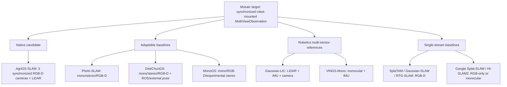
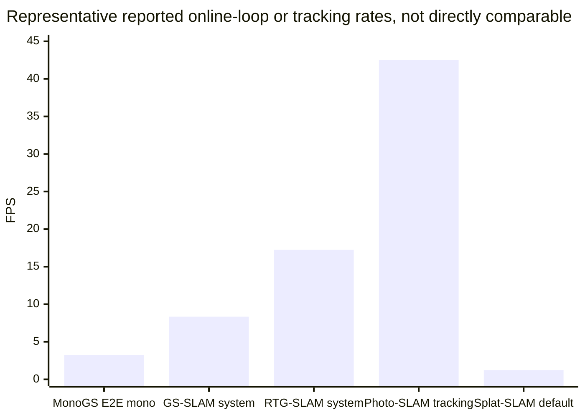

# Open-source multi-view moving-camera online 3D Gaussian Splatting SLAM implementations

Date: 2026-05-18

## Executive Summary

The short answer is: **native multi-camera robot-mounted online 3D Gaussian Splatting SLAM is still rare**. The only implementation found with strong primary-source evidence for a synchronized robot-mounted multi-camera rig is **AgriGS-SLAM**, an Apache-2.0 Visual-LiDAR 3DGS SLAM system for orchard mapping that documents three synchronized RGB-D cameras on a tractor-mounted platform, per-camera calibration, LiDAR odometry/loop closure, and multi-view joint optimization of one shared Gaussian map [1][2][3]. It is the best match to Mosaic's long-term target, but it is domain-specific research code rather than a general-purpose arbitrary-rig library.

Most open-source 3DGS SLAM systems remain **single moving-camera sequence systems**: monocular, RGB-D, or stereo pair. The strongest open baselines for Mosaic are **SplaTAM** for online RGB-D SLAM [4], **MonoGS** for monocular-first Gaussian SLAM with RGB-D and experimental stereo paths [5][6], **Gaussian-SLAM** for MIT-licensed RGB-D dense SLAM [7], **Photo-SLAM** for real-time mono/stereo/RGB-D photorealistic mapping with a GPLv3 C++ stack [8][9], **RTG-SLAM** for real-time RGB-D reconstruction at scale [10][11], and **Google Splat-SLAM** for Apache-2.0 RGB-only globally optimized Gaussian SLAM [15][16]. **GS-SLAM** has important benchmark evidence and a project page, but the only public code confirmed in this pass is modified rasterizer code, not the full SLAM implementation [12][13][14].

For Mosaic, the recommendation is conservative: use the open single-sensor systems to define backend protocols, evaluation artifacts, and baseline adapters first; treat AgriGS-SLAM as the primary native multi-camera backend candidate; and keep every real backend behind optional dependencies or subprocess/container boundaries. Do **not** collapse stereo, RGB-D, multi-agent, and true synchronized multi-camera rig support into one capability flag.

## Scope and classification rules

This report focuses on implementations that are relevant to **online or incremental 3DGS SLAM/mapping from moving cameras**, especially open-source systems. Offline Gaussian reconstruction systems are included only when they are a major SLAM baseline or explain a capability boundary.

Classification rules used throughout:

- **Native multi-camera rig** means documented support for multiple synchronized camera streams on one calibrated robot/vehicle rig.
- **Stereo** is a fixed two-camera modality, not general multi-camera support.
- **RGB-D** is one camera stream with depth, not multi-camera support.
- **Multi-agent** means independent platforms/maps and is not the same as a rigid camera rig.
- **Multi-view** in many 3DGS papers means multiple frames over time; it is not sufficient evidence for multiple robot-mounted cameras.

## Main implementation inventory

| System | Public implementation status | License / reuse risk | Input mode | Online / real-time evidence | Multi-camera relevance | Benchmarks found |
|---|---|---|---|---|---|---|
| **AgriGS-SLAM** | Public repo and demo dataset verified [1][2] | Apache-2.0 for repo; demo dataset CC BY 4.0 [1][2] | Three synchronized RGB-D cameras + LiDAR + GNSS/RTK/odometry | README and paper claim real-time on-tractor Visual-LiDAR 3DGS SLAM [1][3] | **Native multi-camera**: `cam_1`, `cam_2`, `cam_3`, per-camera calibration, joint multi-view optimization [1][2][3] | Apple/pear orchards across dormancy/flowering/harvesting; PSNR/SSIM/LPIPS/ATE; baselines include Photo-SLAM, Splat-SLAM, PINGS, OpenGS-SLAM, DLO+3DGS [3] |
| **SplaTAM** | Public repo verified [4] | BSD-3-Clause [4] | Single RGB-D stream | Online dense RGB-D tracking and mapping; live capture demo via NeRFCapture/iPhone/LiDAR devices [4] | Not native multi-camera; useful RGB-D baseline | Replica, TUM-RGBD, ScanNet, ScanNet++, Replica-V2 [4] |
| **MonoGS / Gaussian Splatting SLAM** | Public repo verified [5] | Custom/non-commercial academic license risk; not MIT/BSD/Apache [5] | Monocular primary; RGB-D and experimental stereo; RealSense live demo [5] | Project reports live operation; paper/repo include headless eval and runtime evidence [5][6] | Adaptable stereo/RGB-D baseline, not generic multi-camera rig | TUM RGB-D, Replica, EuRoC; ATE, PSNR/SSIM/LPIPS, rendering FPS, end-to-end runtime [5][6] |
| **Gaussian-SLAM** | Public repo verified [7] | MIT [7] | RGB-D-style dense SLAM datasets | Public runnable scripts; online/incremental behavior should be verified in source before backend wrapping [7] | Not native multi-camera | Replica, TUM_RGBD, ScanNet, ScanNet++ [7] |
| **Photo-SLAM** | Public repo verified [8] | GPLv3 plus third-party license caveats [8] | Monocular, stereo, RGB-D; RealSense D455 example [8][9] | Explicit real-time SLAM claim; reports desktop/laptop/Jetson performance [8][9] | Strong stereo/RGB-D baseline, not arbitrary rig | Replica, TUM RGB-D, EuRoC; ATE, PSNR/SSIM/LPIPS, tracking/rendering FPS, GPU memory [9] |
| **RTG-SLAM** | Public repo verified [10] | GPL-3.0 [10] | RGB-D camera | Real-time on-the-fly Gaussian optimization and large-scale reconstruction [10][11] | RGB-D only in verified evidence; not multi-camera | Replica, TUM-RGBD, ScanNet++, Azure/self-collected RGB-D; FPS, memory, ATE, geometry [10][11] |
| **GS-SLAM** | Project page and paper verified; full SLAM repo not confirmed [12][13] | Full implementation license not found; modified rasterizer has separate non-standard terms [14] | RGB-D | Paper/project claims real-time tracking, mapping, rendering [12][13] | Not native multi-camera | Replica and TUM-RGBD; ATE, rendering metrics, FPS, memory [13] |
| **Google Splat-SLAM** | Public repo verified [15] | Apache-2.0 [15] | RGB-only / monocular | RGB-only SLAM with global optimization; runtime-quality tradeoffs reported [15][16] | Not native multi-camera | Replica, TUM-RGBD, ScanNet; PSNR/SSIM/LPIPS, ATE, runtime, Gaussian count [16] |
| **DiskChunGS** | Public repo verified [17] | GPLv3 plus Inria/non-commercial third-party Gaussian-splatting caveat [17] | Mono, stereo, RGB-D; ROS/external pose modes [17] | Online large-scale chunked 3DGS SLAM; claims KITTI-scale completion and Jetson validation [17] | Adaptable for ROS/stereo/large-scale robotics, not verified native multi-camera rig | Replica, TUM RGB-D, KITTI [17] |
| **Gaussian-LIC** | Public repo verified [18] | GPL-3.0 shown in repo/README [18] | LiDAR + IMU + camera | Real-time photo-realistic SLAM and Gaussian map construction [18] | Strong robotics multi-sensor reference, but evidence says singular camera, not multi-camera [18] | FAST-LIVO, FAST-LIVO2, R3LIVE, MCD, M2DGR [18] |
| **VINGS-Mono** | Public repo verified [19] | No license shown in verified page [19] | Monocular + inertial | Large-scene visual-inertial Gaussian Splatting SLAM; live/real-time claim not verified in final source check [19] | Not native multi-camera | Hierarchical 3DGS/Hotel, Waymo, KITTI, KITTI360 [19] |
| **HI-SLAM2** | Public repo verified [20] | BSD-3-Clause [20] | Monocular | Fast monocular Gaussian scene reconstruction/SLAM; final check did not verify loop-closure wording [20] | Not native multi-camera | Replica, ScanNet, own/casual videos [20] |

## Native multi-camera finding: AgriGS-SLAM

AgriGS-SLAM is the standout result because it is not merely stereo or RGB-D. The repository and dataset sources document a tractor-mounted orchard platform with **three synchronized RGB-D cameras** and LiDAR/odometry inputs [1][2]. The demo dataset exposes camera IDs `cam_1`, `cam_2`, and `cam_3`, with front-left/front-center/front-right roles, ZED X / ZED X Ultra camera data, Ouster OS0 32-channel LiDAR, and FixPosition GPS/RTK/odometry metadata [2]. The repository configuration/source evidence in the follow-up report found `enabled_cameras: ["cam_1", "cam_2", "cam_3"]`, per-camera intrinsics/extrinsics, and stacked per-camera tensors; the paper-level source describes joint optimization of all camera views against one shared Gaussian map rather than duplicating Gaussians per camera [1][3].

The caveat is that AgriGS-SLAM is **native but domain-specific**. It targets orchards, tractor motion, LiDAR odometry, Scan Context loop closure, and seasonal agricultural data [1][3]. The README explicitly describes the code as research code and not production-ready, and the full multi-season dataset is not fully public yet; the verified dataset is a preview/demo [1][2]. For Mosaic, this makes AgriGS-SLAM the best native multi-camera reference, but not something to absorb into core package code.

## Multi-camera fit classes

**Caption:** Capability classification for Mosaic backend planning. Native multi-camera evidence is strongest for AgriGS-SLAM [1][2][3]. Photo-SLAM, DiskChunGS, and MonoGS are adaptable stereo/RGB-D baselines rather than arbitrary multi-camera rig systems [5][8][17]. Gaussian-LIC and VINGS-Mono are robotics-relevant multi-sensor references but not verified multi-camera rigs [18][19].

### Native candidate

- **AgriGS-SLAM**: verified native multi-camera, Visual-LiDAR, three synchronized RGB-D cameras, orchard tractor platform, Apache-2.0 code [1][2][3].

### Adaptable but not native multi-camera

- **Photo-SLAM**: real-time mono/stereo/RGB-D with broad benchmark coverage and embedded/Jetson results; good stereo baseline, GPLv3 code [8][9].
- **DiskChunGS**: large-scale mono/stereo/RGB-D with ROS/external pose modes and chunked memory management; useful for robot-scale external-pose integration, but licensing and native dependencies are high-risk [17].
- **MonoGS**: monocular-first with RGB-D and experimental stereo paths; valuable for backend capability flags but license and CUDA stack need isolation [5][6].

### Robotics multi-sensor references

- **Gaussian-LIC**: LiDAR-inertial-camera fusion, real-time Gaussian map construction, robotics datasets; useful for future multi-sensor contracts, but verified evidence uses singular camera language [18].
- **VINGS-Mono**: monocular visual-inertial large-scene Gaussian SLAM; useful for VIO/camera calibration contracts, not a multi-camera rig [19].

### Single-stream baselines

- **SplaTAM, Gaussian-SLAM, RTG-SLAM**: RGB-D systems; good for deterministic RGB-D replay, map snapshots, and evaluation schema design [4][7][10][11].
- **Google Splat-SLAM, HI-SLAM2**: RGB-only/monocular systems; useful for scale/depth/loop-closure baseline design, not multi-camera [15][16][20].

## Benchmark evidence and caveats

The benchmark landscape is useful but easy to misread. Papers report several incompatible speed notions: full online SLAM FPS, tracking FPS, mapping iteration time, rendering-only FPS, and post-refinement time. Rendering FPS in the hundreds or thousands is not evidence that the full SLAM loop runs at that rate.

**Caption:** Representative reported rates from benchmark papers: MonoGS end-to-end monocular TUM fr3/office 3.2 FPS [6], GS-SLAM Replica room0 system 8.34 FPS [13], RTG-SLAM Replica Off0 17.24 FPS [11], Photo-SLAM RGB-D desktop tracking about 42.5 FPS [9], and Google Splat-SLAM Replica room0 default 1.24 FPS [16]. These are deliberately labeled as non-comparable because each paper measures a different slice of the pipeline.

| System | Benchmark evidence worth carrying into Mosaic | Key numbers found | Important caveat |
|---|---|---|---|
| **AgriGS-SLAM** | Apple/pear orchard seasons; multi-camera robot rig; PSNR/SSIM/LPIPS/ATE; baselines Photo-SLAM, Splat-SLAM, PINGS, OpenGS-SLAM, DLO+3DGS [3] | Multimodal-loss ablation average: PSNR 26.7204, SSIM 0.8870, LPIPS 0.2177 [3] | Exact per-sequence table extraction was unreliable from PDF text; quote paper tables manually before using as hard gates. Demo dataset is preview-only [2][3]. |
| **MonoGS** | TUM RGB-D and Replica; separates tracking, rendering, runtime, and map size [6] | TUM no-loop average ATE: 3.96 cm monocular, 1.47 cm RGB-D. Replica ATE: 0.58 cm multi-process, 0.32 cm single-process. Replica rendering average: 38.94 PSNR / 0.968 SSIM / 0.070 LPIPS / 769 FPS. End-to-end TUM fr3/office: 3.2 FPS monocular, 2.5 FPS RGB-D [6]. | Monocular ATE uses scale alignment; rendering FPS is not end-to-end SLAM FPS [6]. |
| **GS-SLAM** | RGB-D benchmark reference for ATE, rendering FPS, system FPS, and memory [13] | Replica ATE average 0.50 cm; TUM RGB-D ATE average 3.7 cm. Replica rendering average 34.27 PSNR / 0.975 SSIM / 0.082 LPIPS / 386.91 FPS. Replica room0 system 8.34 FPS, scene memory 198.04 MB [13]. | Full public implementation was not confirmed; use as paper benchmark/reference unless code availability changes [12][14]. |
| **RTG-SLAM** | Real-time RGB-D performance and memory stress evidence [10][11] | Replica Off0: 17.24 FPS, model 71 MB, memory 2751 MB. Azure Home: 17.90 FPS, model 399 MB, memory 8782 MB. TUM RGB-D average ATE 1.06 cm [11]. | ScanNet++ geometry table uses ground-truth poses to isolate geometry, so it is not full online SLAM performance [11]. |
| **Photo-SLAM** | Mono/stereo/RGB-D and embedded runtime baseline [8][9] | Replica desktop monocular: ATE 1.091 cm, PSNR 33.302, tracking 41.646 FPS, rendering 911.262 FPS. Replica desktop RGB-D: ATE 0.604 cm, PSNR 34.958, tracking 42.485 FPS, rendering 1084.017 FPS. Jetson RGB-D: ATE 0.581 cm, tracking 17.926 FPS, rendering 116.395 FPS [9]. | Uses strong feature-based SLAM front end; tracking FPS and rendering FPS are not identical to full Gaussian mapping throughput [9]. |
| **Google Splat-SLAM** | RGB-only quality/runtime tradeoff; useful for camera-only regression gates [16] | Replica average: PSNR 36.45, SSIM 0.95, LPIPS 0.06, ATE 0.35 cm. Replica room0 default runtime 1.24 FPS; faster setting 3.67 FPS with lower PSNR/depth quality [16]. | RGB-only with monocular depth assumptions; some tracking setup inherits from other frameworks [16]. |
| **SplaTAM** | Canonical online RGB-D 3DGS SLAM baseline with broad loaders [4] | Verified repo lists Replica, TUM-RGBD, ScanNet, ScanNet++, Replica-V2; ScanNet++ appendix evidence in the research notes includes novel-view PSNR around 24.41 dB [4]. | Main paper benchmark tables should be manually copied from the paper before hard-coding exact regression thresholds. |

## Source corrections that changed the synthesis

Several apparent contradictions were resolved before finalizing:

1. **RTG-SLAM has public code.** The `MisEty/RTG-SLAM` repository is public and GPL-3.0 [10]. Earlier “no code seen” claims should be discarded.
2. **GS-SLAM full implementation was not confirmed.** The project page points to modified rasterization code; a full public SLAM implementation was not found in the verified sources [12][14].
3. **VIGS-SLAM and VINGS-Mono are different.** VIGS-SLAM's linked `cvg/vigs-slam` repository returned 404 during verification, while VINGS-Mono is a separate public Fudan MAGIC Lab repository [19][21].
4. **Google Splat-SLAM is the implementation line for Erik Sandström's Splat-SLAM.** The final implementation source to cite is `google-research/Splat-SLAM`, Apache-2.0 [15].
5. **Open-source does not mean easy reuse.** SplaTAM, Gaussian-SLAM, Google Splat-SLAM, AgriGS-SLAM, and HI-SLAM2 have comparatively permissive licenses; Photo-SLAM, RTG-SLAM, Gaussian-LIC, and DiskChunGS have GPL or non-commercial/research-license risks; MonoGS uses a custom academic license [1][4][5][7][8][10][15][17][18][20].

## Mosaic backend recommendations

### 1. Treat AgriGS-SLAM as the primary native multi-camera candidate

AgriGS-SLAM should be the first codebase inspected if Mosaic needs a real native multi-camera 3DGS SLAM backend. The adapter should be external/optional and should preserve Mosaic's own typed contracts for:

- camera IDs and per-camera intrinsics/extrinsics,
- synchronized multi-camera observations,
- LiDAR/odometry side channels,
- body/world/camera frame conventions,
- timestamp association policy,
- provenance by camera/time/source,
- benchmark metadata and reproducibility notes.

Do not copy AgriGS's orchard dataset layout or timing assumptions into Mosaic core.

### 2. Use single-stream baselines to harden Mosaic contracts first

Before integrating any heavy backend, use simpler adapters or fake backends to lock down:

- `mono`, `stereo`, `rgbd`, and `multi_camera_rgbd` as distinct capabilities,
- map snapshot metadata: Gaussian count, map frame, source cameras, keyframe IDs,
- tracking output: pose direction, tracking state, diagnostics,
- evaluation artifact schema: ATE/RPE, PSNR/SSIM/LPIPS, depth L1, FPS, GPU memory, map size, seed/hardware.

SplaTAM, MonoGS, Gaussian-SLAM, RTG-SLAM, Photo-SLAM, and Google Splat-SLAM are good reference systems for this schema [4][5][7][8][10][15].

### 3. Keep real backends isolated

Most implementations pin CUDA, PyTorch, C++ extensions, OpenCV with CUDA, ORB-SLAM variants, Pangolin, LibTorch, ROS, or Docker environments [5][8][10][17][18]. Mosaic should expose Python protocols and communicate with these systems through optional packages, subprocesses, containers, or serialized artifacts rather than importing their internals into the pure-Python core.

### 4. Add a multi-camera benchmark gap to Mosaic's roadmap

No clean open benchmark was found for arbitrary multi-camera robot-mounted online 3DGS SLAM across different robot embodiments. AgriGS-SLAM provides the best available native example, but it is agricultural and preview-data-limited [1][2][3]. Mosaic should eventually define its own small deterministic fixture:

- two or three calibrated camera streams,
- explicit body-frame extrinsics,
- controllable timestamp offsets/missing frames,
- RGB-D or synthetic depth for deterministic startup,
- expected map/provenance outputs,
- optional LiDAR/odometry side channel.

## Open questions

1. **How general is AgriGS-SLAM's camera-rig support?** It documents three cameras and per-camera calibration, but the code should be inspected for hard-coded assumptions before treating it as arbitrary-rig support [1][2].
2. **Can AgriGS-SLAM be reproduced outside the orchard dataset?** The full multi-season dataset is not yet fully public, and the verified Hugging Face dataset is a preview/demo [2].
3. **Which license constraints matter for backend adapters?** GPL and custom academic/non-commercial licenses may still be acceptable for isolated experiments, but direct redistribution or embedded use needs legal review [5][8][10][17][18].
4. **What counts as online for Mosaic?** Papers mix online tracking, online mapping, rendering-only FPS, and offline/final refinement. Mosaic should record these separately rather than using one `fps` field [6][9][11][13][16].
5. **How should posterior uncertainty/provenance be evaluated?** Current benchmarks evaluate trajectory, rendering, geometry, runtime, and memory, but not agent-facing posterior quality or provenance calibration.

## Final source list

1. AgriGS-SLAM GitHub repository: https://github.com/AIRLab-POLIMI/agri-gs-slam
2. AgriGS-SLAM demo dataset: https://huggingface.co/datasets/foxmirko/agri-gs-slam-dataset-demo
3. AgriGS-SLAM arXiv abstract: https://arxiv.org/abs/2510.26358
4. SplaTAM GitHub repository: https://github.com/spla-tam/SplaTAM
5. MonoGS GitHub repository: https://github.com/muskie82/MonoGS
6. MonoGS / Gaussian Splatting SLAM arXiv HTML: https://arxiv.org/html/2312.06741
7. Gaussian-SLAM GitHub repository: https://github.com/VladimirYugay/Gaussian-SLAM
8. Photo-SLAM GitHub repository: https://github.com/HuajianUP/Photo-SLAM
9. Photo-SLAM arXiv HTML: https://arxiv.org/html/2311.16728
10. RTG-SLAM GitHub repository: https://github.com/MisEty/RTG-SLAM
11. RTG-SLAM arXiv HTML: https://arxiv.org/html/2404.19706
12. GS-SLAM project page: https://gs-slam.github.io/
13. GS-SLAM arXiv HTML: https://arxiv.org/html/2311.11700
14. GS-SLAM modified rasterizer repository: https://github.com/yanchi-3dv/diff-gaussian-rasterization-for-gsslam
15. Google Research Splat-SLAM repository: https://github.com/google-research/Splat-SLAM
16. Splat-SLAM arXiv HTML: https://arxiv.org/html/2405.16544
17. DiskChunGS GitHub repository: https://github.com/leggedrobotics/DiskChunGS
18. Gaussian-LIC GitHub repository: https://github.com/APRIL-ZJU/Gaussian-LIC
19. VINGS-Mono GitHub repository: https://github.com/Fudan-MAGIC-Lab/VINGS-Mono
20. HI-SLAM2 GitHub repository: https://github.com/Willyzw/HI-SLAM2
21. VIGS-SLAM project page: https://vigs-slam.github.io/
