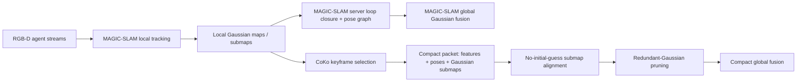

# What CoKo-SLAM Contributes over MAGIC-SLAM

Date: 2026-05-22

## Short answer

CoKo-SLAM is best read as a communication-efficient successor layer on top of MAGIC-SLAM, not as a wholly different multi-agent Gaussian SLAM stack. MAGIC-SLAM establishes the server-mediated RGB-D baseline: local agents build Gaussian submaps, send loop-closure evidence/submaps to a server, and the server performs global alignment, pose-graph optimization, and map fusion. CoKo-SLAM keeps that broad architecture and explicitly builds on MAGIC-SLAM's codebase, but changes the exchange/fusion boundary: it sends compact keyframe feature vectors, camera poses, and Gaussian submaps; adds keyframe selection/optimization; prunes redundant Gaussians; and supports loop closure/alignment without an initial relative-pose guess. The headline practical contribution is therefore bandwidth reduction and compact global fusion while trying to preserve MAGIC-SLAM-like map quality.

## Baseline: what MAGIC-SLAM already provides

The local survey describes MAGIC-SLAM as a server-mediated RGB-D pipeline: each agent performs local tracking, updates local Gaussian maps, partitions them into Gaussian submaps, sends features or Gaussian submaps to a server, and the server performs global alignment plus global fusion before merging those submaps [Yugay et al., 2025; local survey `research/slam-survey/main.tex`]. The paper's external page summarizes the method as a multi-agent 3D Gaussian SLAM system with new tracking, map-merging mechanisms, and loop closure in a Gaussian-based SLAM pipeline [Yugay et al., 2025].

MAGIC-SLAM's distinctive baseline elements are:

- multi-agent RGB-D Gaussian SLAM with globally consistent map fusion;
- local Gaussian submaps rather than raw-image central fusion;
- loop detection using learned image features;
- coarse-to-fine registration and pose-graph optimization for loop constraints;
- map merging/refinement on a central server.

The ar5iv extraction reports MAGIC-SLAM's average ReplicaMultiagent results as about 0.27 cm ATE RMSE, 34.26 dB PSNR, 0.97 SSIM, 0.12 LPIPS, 1.30 cm depth L1, 1.12 GiB peak GPU memory, 54 MB submap storage, and 167 s map merge time on the reported Replica office0 efficiency run [Yugay et al., 2025]. These numbers make it a strong baseline, but also expose the systems bottleneck: global merging is expensive enough to matter as an architectural target.

## CoKo-SLAM's additions

CoKo-SLAM's arXiv abstract and HTML state that it is a compact keyframe-optimized multi-agent Gaussian Splatting SLAM system for bandwidth-limited teams, with up to 85--95% reduction in transmitted data compared with state-of-the-art approaches [Li et al., 2026]. Its repository README also states: "This codebase is based on MAGiC-SLAM" [Li et al., 2026, code]. That matters: the contribution is a focused redesign of the communication and server-side compactness path, not a rejection of the MAGIC-SLAM tracking/fusion family.

### 1. Compact packet boundary

MAGIC-SLAM's baseline is already submap-based, but CoKo-SLAM tightens what crosses the network. The CoKo paper describes agents sending keyframe feature vectors, camera poses, and 3D Gaussian submaps to the server, without relying on point clouds or images in the rendered-depth mode [Li et al., 2026]. This turns the central question from "can we globally merge Gaussian submaps?" into "what is the smallest packet that still supports cross-agent alignment and useful global fusion?"

### 2. Keyframe-optimized selection

CoKo-SLAM adds feature-space keyframe selection: a frame is retained when its feature distance from stored keyframes exceeds a threshold, using DINOv2-Small-style image features according to the arXiv HTML extraction [Li et al., 2026]. The local survey's appendix separates this from MAGIC-SLAM-style RGB-D tracking: CoKo inherits the tracking family but contributes keyframe selection and compact update selection.

### 3. Redundant-Gaussian pruning / compaction

CoKo-SLAM adds a sparsification/compaction stage to remove redundant 3D Gaussians while preserving rendering quality [Li et al., 2026]. In the survey notation, this changes `update_selection` and `global_fusion`: the server does not simply append or merge all incoming primitives; it filters overlap/redundancy before global fusion.

### 4. Loop closure without an initial relative-pose guess

CoKo-SLAM emphasizes inter-agent submap merging without prior knowledge of initial relative poses [Li et al., 2026]. The external extraction describes feature-similarity loop detection followed by FPFH+RANSAC coarse alignment and ICP refinement. This is a practical robotics contribution because independent robots often do not start from a known shared frame.

### 5. Two registration modes: rendered-depth and camera-depth

CoKo-SLAM exposes two operating modes [Li et al., 2026]:

- **Rendered-depth mode:** uses rendered depth from Gaussian submaps, avoiding extra transmitted images/depth.
- **Camera-depth mode:** adds lightweight depth images, improving registration and enabling additional pruning.

This is a useful systems tradeoff knob. Rendered-depth mode better matches strict communication constraints; camera-depth mode spends more bandwidth to improve registration robustness.

## Evidence table

| Claim | Support | Verification status | Caveat |
|---|---|---:|---|
| CoKo-SLAM builds on MAGIC-SLAM rather than replacing the full stack | CoKo GitHub README: "This codebase is based on MAGiC-SLAM"; CoKo arXiv HTML says it builds on MAGIC-SLAM's codebase | verified | Repository confirms ancestry, but paper-level code deltas still require code audit for exact implementation split. |
| MAGIC-SLAM is the strong RGB-D centralized Gaussian-submap baseline | CVPR page, ar5iv extraction, local survey | verified | CVF HTML has limited numeric detail; ar5iv/PDF-derived extraction supplied most numbers. |
| CoKo-SLAM reports 85--95% lower transmitted data | CoKo arXiv abstract/HTML | verified | Relative reduction is clear; independent reproduction and exact per-scene absolute bandwidth require running the code or auditing tables. |
| CoKo-SLAM sends compact keyframe features, camera poses, and Gaussian submaps | CoKo arXiv HTML extraction | verified | Exact serialized format was not independently audited in code. |
| CoKo-SLAM removes redundant Gaussians without degrading rendering quality | CoKo arXiv abstract/HTML | verified as author claim | "Without degrading" is an author-reported claim; should be treated as benchmark-dependent. |
| CoKo-SLAM supports alignment without initial relative poses | CoKo arXiv HTML extraction | verified | Robustness under hard perceptual aliasing or low-resolution depth remains an open question. |
| MAGIC-SLAM merge time is a bottleneck | MAGIC-SLAM ar5iv extraction reports 167 s map merge on Replica office0 | verified from extraction | This is one benchmark setting, not a universal runtime law. |

## Method relationship

## Practical implications for Mosaic

For Mosaic, CoKo-SLAM suggests contracts around **communication-aware map deltas**, not just map snapshots. The useful abstractions would be:

1. a typed keyframe/descriptor packet;
2. a Gaussian-submap summary with explicit serialized size;
3. a redundancy/pruning result that preserves provenance;
4. an alignment result that records whether an initial relative pose was available;
5. benchmark metrics for packet size, merge latency, and quality retention.

The main lesson is that MAGIC-SLAM proves centralized multi-agent Gaussian SLAM can work; CoKo-SLAM asks how little each robot can send while keeping the global map usable.

## Open questions

- The 85--95% communication reduction is well supported as an author claim, but independent reproduction should measure absolute transmitted bytes, packet frequency, and latency per scene.
- CoKo-SLAM's rendered-depth mode depends on registration quality from the current Gaussian submaps; the paper notes lower-resolution settings can hurt this path.
- A code audit would be needed to cleanly separate inherited MAGIC-SLAM components from new CoKo modules at the implementation level.
- Neither paper fully closes the systems-reporting gap for large robot teams: packet schedules, dropped messages, stale updates, and server failure remain underexplored.

## References

- Li, Monica M. Q., Pierre-Yves Lajoie, Jialiang Liu, and Giovanni Beltrame. 2026. *Compact Keyframe-Optimized Multi-Agent Gaussian Splatting SLAM*. arXiv:2604.00804. https://arxiv.org/abs/2604.00804
- Li et al. 2026. CoKo-SLAM code repository. https://github.com/lemonci/coko-slam
- Yugay, Vladimir, Theo Gevers, and Martin R. Oswald. 2025. *MAGiC-SLAM: Multi-Agent Gaussian Globally Consistent SLAM*. CVPR 2025. https://openaccess.thecvf.com/content/CVPR2025/html/Yugay_MAGiC-SLAM_Multi-Agent_Gaussian_Globally_Consistent__SLAM_CVPR_2025_paper.html
- Yugay et al. 2025. MAGiC-SLAM code repository. https://github.com/VladimirYugay/MAGiC-SLAM
- Local source: `research/slam-survey/main.tex` and `research/slam-survey/references.bib`.
