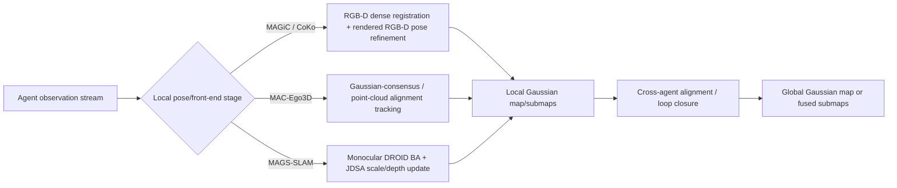

# MAGiC-SLAM Photometric-Depth Tracking vs. `local_tracking`

## Short answer

MAGiC-SLAM's tracking is a **specific RGB-D pose-optimization procedure**: initialize the current relative pose with dense frame-to-frame registration, then freeze the Gaussian map and refine the camera pose by minimizing a masked rendered color/depth loss against the current RGB-D frame [MAGiC-CVPR]. In the local survey, `local_tracking_i` is a **normalized survey operator**, not necessarily a paper or code symbol; for MAC-Ego3D, CoKo-SLAM, and MAGS-SLAM it denotes each agent's local pose-estimation/front-end stage, whose concrete mechanics differ by system [Local-Survey].

The clean distinction is:

- **MAGiC-SLAM:** `tracking = explicit RGB-D frame-to-frame + frame-to-Gaussian-submap pose refinement`.
- **MAC-Ego3D:** `local_tracking = inferred per-agent Gaussian-consensus pose estimation`; code evidence points to point-cloud/FGICP-style tracking and GTSAM pose-graph updates, while RGB/depth rendering losses are clearly in mapping rather than the tracker [MAC-arXiv; MAC-Tracker; MAC-Mapper].
- **CoKo-SLAM:** `local_tracking = survey shorthand`; the paper states its tracking is the same as MAGiC-SLAM, and CoKo's novelty is keyframe selection, Gaussian compaction, and loop closure/registration without initial relative poses [CoKo-arXiv].
- **MAGS-SLAM:** `local_tracking = survey shorthand for local per-agent monocular Gaussian SLAM`; the primary terms are DROID-based front-end, sliding co-visibility window, Joint Depth-Scale Adjustment, local Gaussian mapping, and Sim(3) submap correction, not RGB-D photometric-depth tracking [MAGS-arXiv-html; MAGS-project].

## Terminology alignment

The local survey defines observations, local trajectories, and Gaussian local maps, then introduces:

```tex
\operatorname{local\_tracking}_i
```

as a survey-level operator that estimates a local trajectory from observations and prior local state. The same survey explicitly says the algorithm boxes are **survey-level procedures, not executable source code** [Local-Survey]. Therefore, `local_tracking_i` should be read as a taxonomy label unless a paper or repository independently uses that exact name.



## MAGiC-SLAM: photometric-depth tracking

MAGiC-SLAM is the most concrete case. Its paper describes every agent processing an RGB-D stream while performing local mapping and tracking, using 3D Gaussians for submaps and tracking improvement [MAGiC-CVPR]. The tracking module has two stages.

1. **Frame-to-frame pose initialization.** Given colored point clouds from consecutive RGB-D frames, MAGiC-SLAM estimates a relative transform `T_{t-1,t} ∈ SE(3)` using multi-scale dense registration. The objective combines color and geometric residuals over ICP correspondences and is optimized with Gauss-Newton [MAGiC-CVPR].

2. **Frame-to-model pose refinement.** With that initialization, MAGiC-SLAM freezes all Gaussian parameters and optimizes only the relative camera pose against renderings from the active Gaussian submap. The paper writes this as minimizing a tracking loss over rendered color `\hat I`, rendered depth `\hat D`, input color `I_t`, input depth `D_t`, and rendered alpha [MAGiC-CVPR].

The key loss is a masked RGB/depth residual:

```tex
\mathcal{L}_{tracking}
= \sum M_{inlier} M_{alpha}
\left(\lambda_c |\hat I - I|_1 + (1-\lambda_c)|\hat D - D|_1\right).
```

`M_alpha` focuses the loss on well-reconstructed/high-opacity Gaussian regions, and `M_inlier` removes pixels with large color or depth residuals [MAGiC-CVPR]. The map is the active Gaussian submap, warped/rendered under the candidate relative pose; the Gaussians are not updated during tracking. Mapping, submap creation, loop detection, pose-graph optimization, and submap merging happen in later stages.

So if the survey writes MAGiC as:

```tex
\hat T \leftarrow \arg\min_T \mathcal{L}_{rgbd}(z_t, \operatorname{render}(M_{t-1},T)),
```

that shorthand is faithful to the refinement stage, but it compresses away MAGiC's explicit frame-to-frame initialization and masking details.

## MAC-Ego3D: `local_tracking` as inferred local pose estimation

MAC-Ego3D is an RGB-D multi-agent Gaussian-consensus system. The paper formulates per-agent observations, poses, and local maps, then adds intra-agent and inter-agent consensus terms over Gaussian maps [MAC-arXiv]. The local process includes selection, association, alignment, and optimization: candidate local-map Gaussians are selected around the current view/pose; observed Gaussians or RGB-D-derived points are associated with map Gaussians; pose is refined through likelihood/Mahalanobis-style alignment; the local map is optimized with differentiable rendering [MAC-arXiv-html].

However, `local_tracking` is not a confirmed MAC-Ego3D paper or code term. The checked repository exposes `Tracker.tracking()`, not `local_tracking` [MAC-Tracker]. That tracker performs filtered point-cloud alignment through calls such as `self.reg.align(initial_pose)` and loop-closure alignment through `rel_FGICP.align(current_pose)` plus GTSAM optimization; the raw tracker file did not show an RGB/depth photometric rendering loss [MAC-Tracker]. The RGB/depth rendering losses appear clearly in `mac_Mapper.py`, where mapping uses rendering, L1 RGB, SSIM, and L1 depth losses [MAC-Mapper].

Therefore MAC-Ego3D should not be described as simply copying MAGiC's photometric-depth pose tracker unless another source proves that. In this review, the safer distinction is:

- MAC-Ego3D paper-level local tracking is **Gaussian-consensus local pose estimation** over RGB-D observations and local Gaussian maps.
- MAC-Ego3D code-level tracking, in the checked files, is **geometric/point-cloud alignment plus pose-graph optimization**.
- MAC-Ego3D photometric/depth rendering losses are strongly evidenced for **mapping/consensus optimization**, not as the primary tracker implementation.

## CoKo-SLAM: tracking inherited from MAGiC-SLAM

CoKo-SLAM is the special case: the paper directly states it builds on MAGiC-SLAM's codebase and that its tracking is the same as MAGiC-SLAM; it also says tracking error is not reported for that reason [CoKo-arXiv-html]. The local survey's `local_tracking_i` line for CoKo is therefore a notation choice, not a separate CoKo contribution.

CoKo's new work sits around the tracker:

- feature-vector keyframe selection,
- compact Gaussian-map transmission,
- compaction/sparsification during 3D Gaussian training,
- server-side loop detection,
- FPFH/RANSAC/ICP loop-edge registration,
- pose-graph optimization and global fusion without requiring an initial inter-agent relative pose [CoKo-arXiv-html; CoKo-repo].

The public code confirms the concrete tracking implementation name is `Tracker.track(...)`, not `local_tracking`. It optimizes camera rotation/translation against rendered RGB-D losses from the local Gaussian model, with alpha/depth masks and outlier filtering, matching the MAGiC-style tracker evidence reported by the CoKo paper note [CoKo-repo].

Thus, CoKo differs from MAGiC in **keyframe/update selection, compaction, and server-side registration/fusion**, not in the core local tracking objective.

## MAGS-SLAM: monocular local tracking/mapping, not RGB-D photometric-depth tracking

MAGS-SLAM is fundamentally different because it is **RGB-only / monocular**. Its arXiv page and project page describe local monocular Gaussian submaps, compact submap summaries, geometry/appearance loop verification, occupancy-aware Gaussian fusion, and no active depth sensor [MAGS-arXiv; MAGS-project].

The primary-paper terminology for the local stage is not `local_tracking`. The arXiv HTML describes:

- an independent **DROID-based monocular front-end** for each agent,
- a **sliding co-visibility window**,
- dense bundle adjustment loss `L_BA` over poses and depth maps,
- **Joint Depth-Scale Adjustment (JDSA)**, which couples scale coefficients and depth maps to a learned Metric3D depth prior,
- local Gaussian-map optimization with photometric, depth, normal, and isotropy terms,
- submap freezing after keyframe or motion thresholds,
- per-submap `Sim(3)` corrections for later graph optimization [MAGS-arXiv-html].

So MAGS does have photometric/depth-like local objectives, but the depth is produced/regularized by monocular depth and scale-estimation machinery rather than supplied by an RGB-D sensor. Its local stage optimizes pose, depth, scale, and Gaussian-map state inside bounded submaps; cross-agent consistency is handled later by Sim(3) submap graph optimization and occupancy-aware fusion [MAGS-arXiv-html].

## Comparison table

| System | Is `local_tracking` a primary term? | Input modality | Tracking/front-end evidence | What is optimized locally? | Main distinction from MAGiC photometric-depth tracking |
|---|---:|---|---|---|---|
| MAGiC-SLAM | No; paper says hybrid implicit tracking | RGB-D | Dense frame-to-frame registration, then masked rendered RGB/depth frame-to-model refinement | Relative camera pose `T_{t-1,t}` during tracking; Gaussians frozen | This is the explicit photometric-depth tracker being compared against. |
| MAC-Ego3D | No; survey/inferred stage | RGB-D | Intra-agent Gaussian consensus; code tracker uses point-cloud/FGICP-style alignment and GTSAM | Per-agent poses and local maps; tracker code optimizes pose via alignment, mapper optimizes Gaussians with RGB/depth rendering losses | More consensus/geometric-alignment framed; photometric-depth rendering loss is evidenced for mapping, not clearly for tracker code. |
| CoKo-SLAM | No; survey/inferred stage | RGB-D | Paper states tracking is the same as MAGiC-SLAM; code tracker uses rendered RGB-D loss | Camera pose in inherited/MAGiC-style tracker; CoKo adds keyframe/compaction/server steps | No material local-tracking difference from MAGiC; differences are update selection, compaction, and loop closure. |
| MAGS-SLAM | No; survey/inferred stage | Monocular RGB | DROID-based dense BA, JDSA, local Gaussian mapping, Sim(3) submaps | Poses, depth maps, scale coefficients, local Gaussian parameters | Monocular scale/depth-aware front end, not active RGB-D rendered-depth pose tracking. |

## Consensus

1. `local_tracking_i` in the local survey is a unifying notation, not necessarily each method's own implementation name [Local-Survey].
2. MAGiC-SLAM and CoKo-SLAM are closest in local tracking; CoKo explicitly inherits MAGiC tracking [CoKo-arXiv-html].
3. MAC-Ego3D and MAGS-SLAM both have local pose/front-end stages, but their primary framing differs: MAC-Ego3D emphasizes Gaussian consensus and geometric/point-cloud alignment, while MAGS-SLAM emphasizes monocular BA, learned depth priors, scale adjustment, and Sim(3) submaps [MAC-arXiv-html; MAGS-arXiv-html].
4. A generic line such as `local_tracking_i(Z_i, M_i)` is useful for survey taxonomy, but it hides differences in sensor modality, objective terms, optimized variables, and coupling to mapping.

## Disagreements or evidence-sensitive points

- **MAC-Ego3D tracker objective:** the paper discusses local Gaussian alignment and differentiable rendering, but the checked tracker source points to geometric registration while rendering losses appear in mapping. I therefore avoid saying MAC-Ego3D's tracker is a MAGiC-style photometric-depth render optimizer.
- **CoKo code vs paper wording:** the CoKo paper says tracking is the same as MAGiC-SLAM; the public code also contains an RGB-D rendered-loss tracker. That is consistent, but exact line-level code evidence came from static inspection, not execution.
- **MAGS code availability:** MAGS-SLAM code/data were not available in the checked project page, so all MAGS implementation claims are paper-level, not code-verified [MAGS-project].

## Open questions / follow-up checks

1. Clone and grep the latest MAC-Ego3D repository for any tracker branches or config modes that introduce a rendered RGB-D pose loss beyond `mac_Tracker.py`.
2. Run CoKo-SLAM/MAGiC-SLAM on a tiny RGB-D sequence and compare the tracker loss traces to verify whether CoKo's tracker is behaviorally identical to MAGiC's current public code.
3. Re-check MAGS-SLAM after acceptance/code release to see whether the implementation names the local front-end `local_tracking` or exposes different optimization scheduling than the arXiv paper.

## Citations

- [Local-Survey] Local source: `research/slam-survey/main.tex`, especially notation around `local_tracking_i` and the warning that algorithm boxes are survey-level procedures.
- [MAGiC-CVPR] Yugay, Gevers, and Oswald, “MAGiC-SLAM: Multi-Agent Gaussian Globally Consistent SLAM,” CVPR 2025. https://openaccess.thecvf.com/content/CVPR2025/html/Yugay_MAGiC-SLAM_Multi-Agent_Gaussian_Globally_Consistent__SLAM_CVPR_2025_paper.html
- [MAC-arXiv] Xu et al., “MAC-Ego3D: Multi-Agent Gaussian Consensus for Real-Time Collaborative Ego-Motion and Photorealistic 3D Reconstruction,” arXiv:2412.09723. https://arxiv.org/abs/2412.09723
- [MAC-arXiv-html] MAC-Ego3D arXiv HTML method extraction. https://arxiv.org/html/2412.09723
- [MAC-Tracker] MAC-Ego3D tracker source. https://raw.githubusercontent.com/Xiaohao-Xu/MAC-Ego3D/main/mac_Tracker.py
- [MAC-Mapper] MAC-Ego3D mapper source. https://raw.githubusercontent.com/Xiaohao-Xu/MAC-Ego3D/main/mac_Mapper.py
- [CoKo-arXiv] Li et al., “Compact Keyframe-Optimized Multi-Agent Gaussian Splatting SLAM,” arXiv:2604.00804. https://arxiv.org/abs/2604.00804
- [CoKo-arXiv-html] CoKo-SLAM arXiv HTML method extraction. https://arxiv.org/html/2604.00804
- [CoKo-repo] CoKo-SLAM repository. https://github.com/lemonci/coko-slam
- [MAGS-arXiv] Cao et al., “MAGS-SLAM: Monocular Multi-Agent Gaussian Splatting SLAM for Geometrically and Photometrically Consistent Reconstruction,” arXiv:2605.10760. https://arxiv.org/abs/2605.10760
- [MAGS-arXiv-html] MAGS-SLAM arXiv HTML method extraction. https://arxiv.org/html/2605.10760
- [MAGS-project] MAGS-SLAM project page. https://mags-slam.github.io/
