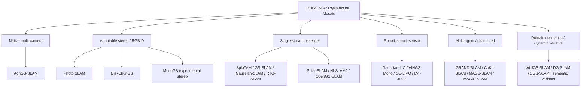

# A Catalogue of Online and Incremental 3D Gaussian Splatting SLAM Systems for Moving Robotic Cameras

## Abstract

This draft catalogues 3D Gaussian Splatting (3DGS) SLAM systems relevant to moving robotic cameras, with emphasis on public implementation status, sensing modality, online behavior, native multi-camera support, benchmark evidence, and fit as future Mosaic backend references. The central finding is conservative: verified native multi-camera robot-rig support is rare. AgriGS-SLAM is the strongest native multi-camera candidate found, with primary-source evidence for a tractor-mounted three-RGB-D-camera Visual-LiDAR 3DGS SLAM pipeline [C1-C3]. Most other systems are better classified as monocular, RGB-D, stereo, LiDAR-inertial-camera, semantic/dynamic, or multi-agent baselines rather than synchronized multi-camera robot-rig backends. For Mosaic, the practical path is to use single-stream and stereo/RGB-D systems to harden typed backend and evaluation contracts, while treating heavy real backends as optional isolated adapters.

## Problem Statement

Mosaic needs stable contracts for multi-view moving robot cameras, but the 3DGS SLAM literature often uses terms such as *multi-view*, *real-time*, *online*, *RGB-D*, *stereo*, and *multi-agent* inconsistently. A catalogue is useful only if it refuses the common shortcut: stereo or RGB-D is not the same thing as a synchronized calibrated multi-camera robot rig. This draft therefore distinguishes five categories:

1. **Native multi-camera rig** — multiple synchronized cameras on one calibrated moving platform.
2. **Adaptable stereo/RGB-D** — useful for rig contracts, but not arbitrary multi-camera support.
3. **Single-stream RGB-D or monocular** — good baseline systems and evaluation references.
4. **Robotics multi-sensor** — camera plus LiDAR/IMU/GNSS, usually one camera.
5. **Multi-agent/distributed** — multiple agents or sessions, not one rigid camera rig.

## Related Work

The first wave of 3DGS SLAM systems adapted Gaussian maps to online RGB-D or monocular tracking and mapping, including SplaTAM, GS-SLAM, Gaussian-SLAM, MonoGS, Photo-SLAM, RTG-SLAM, and Splat-SLAM [C4-C17]. Later systems extend the representation toward loop closure, uncertainty, semantics, dynamic scenes, out-of-core scale, visual-inertial or LiDAR-inertial fusion, and multi-agent map composition [C18-C43]. Robotics-oriented systems such as Gaussian-LIC, DiskChunGS, VINGS-Mono, GS-LIVO, LVI-3DGS, and AgriGS-SLAM are especially relevant to Mosaic because they expose the engineering pressure points: calibration, timing, native dependencies, online memory control, and dataset-specific preprocessing [C1][C2][C23][C27][C32][C33][C41][C42].

## Catalogue Method and Classification Rules

The catalogue synthesizes the completed deep-research artifacts in `outputs/`, especially the final report, code inventory, multi-camera fit analysis, benchmark extraction, AgriGS-SLAM follow-up, and corrections report. Each row is classified by source confidence:

- **Verified** — primary repo/project/paper was checked in the previous research pass or this draft pass.
- **Survey-level** — included from the intermediate literature survey; useful lead, but not enough for direct backend decisions.
- **Unverified / promised** — code or benchmark claims were visible only as promised, inaccessible, or abstract-level evidence.

The multi-camera column uses a strict rule:

\[
\text{native multi-camera} \Rightarrow \text{documented synchronized camera IDs + calibrated rig or explicit multi-camera ingestion.}
\]

By that rule, stereo, RGB-D, multi-agent, and temporal multi-view sequences do not count as native multi-camera robot-rig support unless the source documents a more general rig.

## Capability Taxonomy

**Figure 1.** Capability taxonomy for Mosaic backend planning. AgriGS-SLAM is the only verified native multi-camera candidate in this catalogue; the other branches are still useful, but for different contract and evaluation problems.

## Evidence Catalogue

| System / model | Year | Code status and license | Sensor modality | Online status | Multi-camera relevance | Benchmarks / datasets found | Mosaic fit | Sources |
|---|---:|---|---|---|---|---|---|---|
| **AgriGS-SLAM** | 2025/2026 | Public repo, Apache-2.0; demo dataset CC BY 4.0 | Three synchronized RGB-D cameras + LiDAR + GNSS/RTK/odometry | Reported real-time on-tractor | **Native multi-camera**: `cam_1`, `cam_2`, `cam_3`, per-camera calibration, joint multi-view map optimization | Apple/pear orchards across dormancy/flowering/harvesting; PSNR/SSIM/LPIPS/ATE; Photo-SLAM, Splat-SLAM, PINGS, OpenGS-SLAM baselines | **Primary native multi-camera candidate**, but domain-specific research code | [C1-C3] |
| **SplaTAM** | 2023/2024 | Public repo, BSD-3-Clause | Single RGB-D stream | Online tracking and mapping | Not native multi-camera | Replica, TUM-RGBD, ScanNet, ScanNet++, Replica-V2 | Best permissive RGB-D baseline for backend contracts | [C4][C5] |
| **MonoGS / Gaussian Splatting SLAM** | 2023/2024 | Public repo; custom/non-commercial academic license risk | Monocular primary; RGB-D and experimental stereo; RealSense live demo | Live/online; paper reports end-to-end FPS | Stereo/RGB-D adaptable, not native rig | TUM RGB-D, Replica, EuRoC; ATE, PSNR/SSIM/LPIPS, runtime | Key monocular/RGB-D baseline; isolate license/deps | [C6][C7] |
| **Gaussian-SLAM** | 2023/2024 | Public repo, MIT | RGB-D-style dense SLAM datasets | Online/incremental behavior reported; source inspection advised | Not native multi-camera | Replica, TUM_RGBD, ScanNet, ScanNet++ | Good permissive dense RGB-D implementation reference | [C8] |
| **Photo-SLAM** | 2023/2024 | Public repo, GPLv3 plus third-party caveats | Monocular, stereo, RGB-D; RealSense D455 | Real-time SLAM | Strong stereo/RGB-D baseline, not arbitrary rig | Replica, TUM RGB-D, EuRoC; desktop/laptop/Jetson runtime | Excellent runtime/stereo reference; not core dependency material | [C9][C10] |
| **RTG-SLAM** | 2024 | Public repo, GPL-3.0 | RGB-D | Real-time, on-the-fly Gaussian optimization | RGB-D only in verified evidence | Replica, TUM-RGBD, ScanNet++, Azure/self-collected RGB-D; FPS, memory, ATE, geometry | Strong real-time RGB-D stress benchmark; isolate GPL/CUDA stack | [C11][C12] |
| **GS-SLAM** | 2023/2024 | Project/paper verified; full SLAM implementation not confirmed; modified rasterizer public | RGB-D | Paper/project report real-time tracking, mapping, rendering | Not native multi-camera | Replica, TUM-RGBD; ATE, rendering metrics, FPS, memory | Use as paper benchmark/reference, not as confirmed full backend code | [C13-C15] |
| **Splat-SLAM / Google Splat-SLAM** | 2024 | Public repo, Apache-2.0 | RGB-only / monocular with depth estimation | Online-ish RGB-only SLAM with global optimization and runtime tradeoffs | Not native multi-camera | Replica, TUM-RGBD, ScanNet; PSNR/SSIM/LPIPS, ATE, runtime, Gaussian count | Strong permissive RGB-only baseline | [C16][C17] |
| **CG-SLAM** | 2024 | Project says source will be public; code status should be rechecked | RGB-D, uncertainty-aware Gaussian field | Online / near real-time reported | Not native multi-camera | Compared with PointSLAM, Co-SLAM, NeRF-SLAM and Gaussian methods | Uncertainty-aware design reference; not first backend target | [C18] |
| **LoopSplat** | 2024 | Project says code available | RGB-D / submap loop closure | Online loop closure, not necessarily real-time | Not native multi-camera | Replica, TUM-RGBD, ScanNet, ScanNet++ | Useful for future submap/fusion/provenance APIs | [C19] |
| **EndoGSLAM** | 2024 | Project links code/data/pretrain | Endoscopic RGB-D / surgical imagery | Real-time surgical tracking/reconstruction | Domain-specific, not robot-rig multi-camera | Endoscopic datasets; ORB-SLAM3 / Endo-Depth comparisons visible | Domain edge case; low immediate Mosaic fit | [C20] |
| **HI-SLAM2** | 2024/2025 | Public repo, BSD-3-Clause | Monocular | Online/incremental claims in survey; final URL check confirmed fast monocular Gaussian reconstruction | Not native multi-camera | Replica, ScanNet, ScanNet++, Waymo/project examples | Permissive monocular reference after evaluation gates exist | [C21] |
| **WildGS-SLAM** | 2025 | Public repo, Apache-2.0 | Monocular dynamic scenes | Tracks camera and builds static Gaussian map while suppressing dynamic objects | Not native multi-camera | Wild-SLAM, Bonn Dynamic, TUM RGB-D dynamic, custom data | Dynamic-scene robustness reference | [C22] |
| **DiskChunGS** | 2026 | Public repo; GPLv3 + Inria/non-commercial third-party caveat | Mono, stereo, RGB-D; ROS/external pose modes | Online large-scale chunked 3DGS SLAM | Adaptable stereo/ROS/external-pose reference, not native rig | Replica, TUM RGB-D, KITTI; Jetson/KITTI claims | Best large-scale/ROS memory-management reference; high integration risk | [C23] |
| **SEGS-SLAM** | 2025 | Public repo, GPL-3.0 | RGB-D and monocular workflows; RealSense | Real-time SLAM reported by repo | Not native multi-camera | Replica, TUM RGB-D, VECtor | Structure/appearance embedding reference; license/deps risk | [C24] |
| **OpenGS-SLAM** | 2025 | Public repo, MIT | RGB-only outdoor | Real-time interactive SLAM window reported | Waymo data is multi-camera, but implementation evidence is not native rig support | Waymo segments / unbounded outdoor scenes | Outdoor RGB-only baseline; not multi-camera | [C25] |
| **DG-SLAM** | 2024 | Public repo, MIT | RGB-D dynamic scenes + semantic motion masks | Online/offline status unclear from README | Not native multi-camera | TUM RGB-D dynamic, Bonn Dynamic RGB-D, ScanNet | Dynamic RGB-D baseline | [C26] |
| **LSG-SLAM** | 2026 | Public repo, BSD-3-Clause | EuRoC/KITTI with preprocessing | Two-stage front end + loop closure + backend refinement | Not native multi-camera | EuRoC, KITTI | Large-scale loop-closure reference; not native rig | [C27] |
| **GSORB-SLAM** | 2025 | Public repo; license mixed/unclear in research notes | RGB-D | SLAM experiments reported | Not native multi-camera | TUM-RGBD, Replica, ScanNet | ORB-style RGB-D Gaussian baseline; needs license review | [C28] |
| **SemGauss-SLAM** | 2025 | Public repo; no license visible in survey metadata | RGB-D + semantic labels | Online-ish reconstruction/visualization scripts | Not native multi-camera | Replica, ScanNet | Agent-semantic map reference, not backend priority | [C29] |
| **Hier-SLAM** | 2025 | Public repo, Apache-2.0 | RGB-D + hierarchical semantic categories | Online-ish reconstruction scripts | Not native multi-camera | Replica, ScanNet | Semantic hierarchy reference for later agent-facing maps | [C30] |
| **CaRtGS** | 2025 | Public repo, GPL-3.0 per GitHub metadata in research notes | RGB-D | Real-time GS SLAM experiments | Not native multi-camera | TUM-RGBD, Replica, ScanNet | Computational alignment reference; high native-dep/license risk | [C31] |
| **MDGS_SLAM** | 2026 | Public repo, Apache-2.0 | RGB-D; modified ORB-SLAM2 binding | Real-time RGB-D SLAM reported | “Multi-view” means densification over views/keyframes, not synchronized multi-camera rig | Replica, TUM-RGBD, custom/Ours | Useful cautionary example: multi-view terminology is not multi-camera | [C32] |
| **RTGS** | 2025 | Public repo; sparse evidence, license not visible in survey | Real-time 3DGS SLAM hardware/algorithm focus | Likely online from title, not deeply verified | Unknown | Sparse public evidence | Hardware/performance lead only | [C33] |
| **MonoRTGS / MonoRTGS_ONX** | 2026 | Public derivative repos; license not clearly stated | RGB-D, stereo, mono, live configs | Real-time / edge-GPU focus | Stereo/RGB-D configs, not native rig | TUM, Replica configs | Edge/hardware-speedup lead; derivative risk | [C34][C35] |
| **Gaussian-LIC** | 2024/2025 | Public repo; GPL-3.0 per repo/README evidence | LiDAR + IMU + camera | Real-time pose estimation and Gaussian map construction | Strong multi-sensor robotics; singular camera evidence | FAST-LIVO, FAST-LIVO2, R3LIVE, MCD, M2DGR | Key robotics multi-sensor backend reference; not multi-camera | [C36] |
| **LIV-GaussMap** | 2024 | Paper-level; authors claim software/hardware/datasets released | LiDAR + inertial + visual | Real-time rendering; online status less clear | Multi-sensor, not verified multi-camera | Diverse LIV datasets | Robotics radiance-field mapping reference | [C37] |
| **LVI-GS** | 2024 | Paper-level in survey; code not confirmed | LiDAR + camera + inertial | Real-time photorealistic mapping reported | Multi-sensor, not verified multi-camera | Numerical experiments; no named benchmark in survey excerpt | Robotics sensor-fusion reference | [C38] |
| **LiV-GS** | 2024 | Paper-level in survey; code not confirmed | LiDAR + vision | Outdoor SLAM; 7.98 FPS reported in survey | Multi-sensor, not verified multi-camera | Outdoor comparative experiments | Outdoor multi-sensor reference | [C39] |
| **GS-LIVO** | 2025 | Repo/README evidence in research; public status reported | LiDAR + IMU + camera/visual | Real-time LIVO with Gaussian updates | Multi-sensor, not verified multi-camera | MARS-LVIG, Landmark, UAV Playground, FAST-LIVO HKU; Jetson Orin NX | Strong LIVO architecture reference | [C40][C41] |
| **Gaussian-LIC2** | 2025 | Paper says code/dataset will be public | Camera + LiDAR + inertial | Real-time incremental Gaussian map | Multi-sensor, not verified multi-camera | Dedicated LIC dataset with GT poses/depth | Promising but treat as promised-code until reverified | [C42] |
| **LIVE-GS** | 2025/2026 | Code not confirmed in survey | LiDAR + inertial + visual | Explicit online LIV SLAM framework | Multi-sensor, not verified multi-camera | Public and authors’ datasets | Future LIV consistency reference | [C43] |
| **RMGS-SLAM** | 2026 | Code not confirmed in survey | Hardware-synchronized LiDAR-camera-IMU | Real-time, continuous mapping and loop closure reported | Multi-sensor, not multi-camera from available evidence | Public + authors’ outdoor dataset | Future outdoor real-time multi-sensor reference | [C44] |
| **VIGS-SLAM** | 2025/2026 | Project page reachable; linked code repo returned 404 in previous verification | RGB frames + IMU | Project reports real-time tracking/map updates/loop closure | Visual-inertial, not native multi-camera | Five challenging datasets claimed | Conceptual VI reference; code not available at cited link | [C45] |
| **VINGS-Mono** | 2025 | Public repo; no license visible in final check | Monocular + inertial | Large-scene VI Gaussian SLAM; real-time not fully verified in final check | Not native multi-camera | Hotel, Waymo, KITTI, KITTI360 | Public VI baseline candidate after license check | [C46] |
| **GRAND-SLAM** | 2025 | Paper-level; code not confirmed | Multi-agent RGB-D visual SLAM | Collaborative large-scale SLAM | Multi-agent, not one rig | Replica, Kimera-Multi; PSNR/tracking-error claims | Distributed map/fusion reference only | [C47] |
| **CoKo-SLAM** | 2026 | Public repo/project evidence but maturity varies by repo | RGB-D multi-agent | Multi-agent collaborative SLAM | Multi-agent, not native rig | ReplicaMultiagent, AriaMultiagent | Compact keyframe/map exchange idea source | [C48] |
| **MAGS-SLAM** | 2026 | No code release confirmed in survey | Monocular RGB-only multi-agent | Real-time collaborative mapping reported | Multi-agent, not native rig | ReplicaMultiagent Plus; synthetic/real datasets | Multi-agent map-composition reference | [C49] |
| **MAGiC-SLAM** | 2026-ish | Public repo in research notes | Multi-agent RGB-only | Multi-agent Gaussian SLAM | Multi-agent, not camera rig | ReplicaMultiagent, AriaMultiagent | Session/agent fusion reference | [C50] |
| **M^3** | 2026 | Project page points to code; not deeply verified | Uncalibrated monocular video + multi-view foundation models | Streaming/online reconstruction and refinement | Not native multi-camera | Indoor/outdoor, ScanNet++ | Future monocular depth/pose robustness reference | [C51] |
| **MM3DGS-SLAM** | 2026-ish | Public repo in research notes | RGB + depth + IMU/LiDAR evidence | Robot/dataset stream | Multi-modal single camera, not native multi-camera | UT-MM, TUM-RGBD, Jackal pose topic | Useful for typed multi-modal observation contracts | [C52] |
| **TRGS-SLAM** | 2026-ish | Public repo in research notes | Thermal camera + IMU | Thermal-inertial SLAM | Not native multi-camera | TRNeRF indoor/outdoor sequences | Specialized thermal modality reference | [C53] |
| **SGS-SLAM** | 2024 | Public repo in research notes | RGB-D + semantic/object labels | RGB-D semantic SLAM | Not native multi-camera | Replica, ScanNet, ScanNet++ | Semantic mapping reference for future agent APIs | [C54] |
| **2DGS-SLAM** | 2025-ish | Public repo in research notes | RGB-D / 2D Gaussian Splatting; RealSense/iPhone LiDAR examples | RGB-D SLAM | Not native multi-camera | Replica, TUM RGB-D, ScanNet, Stray Scanner | Alternate splat primitive reference | [C55] |
| **VTGaussian-SLAM** | 2025 | Public repo in research notes | RGB-D | RGB-D SLAM | Not native multi-camera | Replica, TUM-RGBD, ScanNet, ScanNet++ | Large-scale RGB-D baseline candidate | [C56] |
| **GSFusion** | 2025-ish | Public repo in research notes | RGB-D mapping; optional Kinect/OpenNI2 | Mapping/reconstruction; tracking scope should be verified | Not native multi-camera | Replica, ScanNet++, TUM-RGBD | Mapping reference, not first SLAM backend | [C57] |
| **S3PO-GS** | 2025 | Public repo in research notes | Outdoor monocular | Outdoor monocular SLAM | Not native multi-camera | Waymo, KITTI, DL3DV | Outdoor monocular baseline | [C58] |
| **VarSplat** | 2026 | Survey-level / code not confirmed | RGB-D uncertainty-aware SLAM | Online status not deeply verified | Not native multi-camera | Replica, TUM-RGBD, ScanNet, ScanNet++ | Uncertainty design lead only | [C59] |
| **MipSLAM** | 2026 | Survey-level GitHub mention | Camera-based 3DGS SLAM | Not deeply verified | Not native multi-camera | Replica, TUM | Alias-free rendering/SLAM lead only | [C59] |
| **GS3LAM** | 2026 | Survey-level GitHub mention | RGB + depth + semantics | Not deeply verified | Not native multi-camera | Benchmark datasets unnamed in survey excerpt | Semantic 3DGS lead only | [C59] |
| **SGAD-SLAM** | 2026 | Survey-level project mention | RGB-D | Not deeply verified | Not native multi-camera | Widely used benchmarks, unnamed in survey excerpt | Depth-adjustment lead only | [C59] |
| **D²GSLAM / DAGS-SLAM / RU4D-SLAM / VBGS-SLAM group** | 2025/2026 | Mixed survey-level evidence | Dynamic / compact / 4D variants | Mixed | Not native multi-camera in available evidence | Dynamic RGB-D or standard benchmarks | Track as future dynamic/4D branch, not backend candidate yet | [C59] |
| **NeRF/3DGS SLAM in the Wild Benchmark** | 2026-ish | Benchmark repo, not backend | Benchmark covers mono/RGB-D/stereo sensors | Evaluation benchmark | Benchmark, not multi-camera backend | ROVER subset; MonoGS, Photo-SLAM, Splat-SLAM comparisons | Useful future regression source if data stabilizes | [C60] |

## Benchmark Evidence and Comparability

The strongest numeric benchmark evidence in the completed research is concentrated in MonoGS, GS-SLAM, RTG-SLAM, Photo-SLAM, and Splat-SLAM. The numbers below are intentionally compact and should not be compared as a leaderboard because each paper measures different pipeline slices.

| System | Representative reported evidence | Why it matters for Mosaic | Main caveat |
|---|---|---|---|
| MonoGS | TUM no-loop ATE averages: 3.96 cm monocular, 1.47 cm RGB-D; Replica RGB-D ATE 0.58 cm multi-process / 0.32 cm single-process; end-to-end TUM fr3/office 3.2 FPS monocular and 2.5 FPS RGB-D | Separates trajectory, rendering, map size, and end-to-end runtime fields | Rendering FPS is much higher than full SLAM FPS; monocular scale alignment differs from RGB-D [C7] |
| GS-SLAM | Replica ATE average 0.50 cm; Replica rendering 34.27 PSNR / 0.975 SSIM / 386.91 rendering FPS; Replica room0 system 8.34 FPS | Good example of tracking/rendering/system-FPS split | Full public SLAM implementation not confirmed [C13-C15] |
| RTG-SLAM | Replica Off0 17.24 FPS, model 71 MB, memory 2751 MB; Azure Home 17.90 FPS, model 399 MB, memory 8782 MB; TUM average ATE 1.06 cm | Strong stress case for runtime and memory metadata | ScanNet++ geometry table uses ground-truth poses; not all metrics are full SLAM [C11][C12] |
| Photo-SLAM | Replica desktop RGB-D ATE 0.604 cm, PSNR 34.958, tracking 42.485 FPS, rendering 1084.017 FPS; Jetson RGB-D tracking 17.926 FPS | Closest benchmark evidence for stereo/RGB-D embedded operation | Strong ORB-SLAM-style front end; tracking/rendering FPS not full Gaussian-map throughput [C9][C10] |
| Splat-SLAM | Replica average PSNR 36.45, SSIM 0.95, LPIPS 0.06, ATE 0.35 cm; room0 default 1.24 FPS | RGB-only quality/runtime tradeoff reference | Depends on monocular depth and some inherited tracking setup [C16][C17] |
| AgriGS-SLAM | Orchard seasons with PSNR/SSIM/LPIPS/ATE; cleanly extracted multimodal-loss ablation average PSNR 26.7204, SSIM 0.8870, LPIPS 0.2177 | Only native multi-camera benchmark-style evidence | Full per-sequence table extraction was unreliable; demo dataset is preview-only [C1-C3] |

## Mosaic Synthesis

For Mosaic, the catalogue suggests a layered backend strategy:

1. **Core contract baselines:** Start with SplaTAM, MonoGS, Gaussian-SLAM, RTG-SLAM, Photo-SLAM, and Splat-SLAM as examples for observation contracts, tracking outputs, map snapshots, and benchmark artifact schemas.
2. **Native multi-camera investigation:** Inspect AgriGS-SLAM first for actual multi-camera ingestion, calibration representation, synchronization assumptions, and LiDAR/odometry coupling.
3. **Robotics sensor-fusion references:** Use Gaussian-LIC, DiskChunGS, GS-LIVO, LVI-3DGS, VINGS-Mono, and MM3DGS-SLAM to shape optional sensor side channels without contaminating the pure-Python core.
4. **Agent-facing future work:** Semantic systems such as SGS-SLAM, SemGauss-SLAM, Hier-SLAM, and GS3LAM are relevant later for bounded scene summaries, but not for initial backend integration.
5. **Governance rule:** Real 3DGS SLAM backends should run behind optional packages, subprocesses, containers, or serialized artifact boundaries because CUDA/C++/ROS/license assumptions are not stable enough for Mosaic core.

## Limitations

- The 3DGS SLAM landscape is moving fast; 2025-2026 systems may change code availability after this catalogue.
- Some rows are survey-level only and should not be treated as verified implementation candidates.
- License labels are research aids, not legal advice.
- FPS values are not directly comparable: rendering FPS, tracking FPS, system FPS, and final refinement time are often different quantities.
- AgriGS-SLAM is the strongest native multi-camera candidate, but it is orchard/tractor-specific and the full multi-season dataset was not verified as public in the completed research.
- Several systems use project names that collide or differ only slightly: Splat-SLAM vs SplaTAM, RTG-SLAM vs RTGS, VIGS-SLAM vs VINGS-Mono, GS-SLAM vs Gaussian-SLAM.

## Conclusion

The catalogue supports one blunt conclusion: **do not treat “3DGS SLAM” as a single backend category.** For Mosaic, AgriGS-SLAM is the only verified native multi-camera robot-rig candidate found, while SplaTAM, MonoGS, Gaussian-SLAM, Photo-SLAM, RTG-SLAM, GS-SLAM, and Splat-SLAM are stronger as baseline and evaluation references. Robotics multi-sensor systems are important, but they mostly solve camera-plus-LiDAR/IMU fusion rather than multiple robot-mounted cameras. The right architecture is therefore a typed pure-Python contract layer with optional, isolated backend adapters and a benchmark schema that records modality, camera count, calibration, runtime decomposition, and provenance explicitly.

## Sources

- [C1] AgriGS-SLAM GitHub repository: https://github.com/AIRLab-POLIMI/agri-gs-slam
- [C2] AgriGS-SLAM demo dataset: https://huggingface.co/datasets/foxmirko/agri-gs-slam-dataset-demo
- [C3] AgriGS-SLAM arXiv: https://arxiv.org/abs/2510.26358
- [C4] SplaTAM GitHub repository: https://github.com/spla-tam/SplaTAM
- [C5] SplaTAM arXiv: https://arxiv.org/abs/2312.02126
- [C6] MonoGS GitHub repository: https://github.com/muskie82/MonoGS
- [C7] MonoGS / Gaussian Splatting SLAM arXiv HTML: https://arxiv.org/html/2312.06741
- [C8] Gaussian-SLAM GitHub repository: https://github.com/VladimirYugay/Gaussian-SLAM
- [C9] Photo-SLAM GitHub repository: https://github.com/HuajianUP/Photo-SLAM
- [C10] Photo-SLAM arXiv HTML: https://arxiv.org/html/2311.16728
- [C11] RTG-SLAM GitHub repository: https://github.com/MisEty/RTG-SLAM
- [C12] RTG-SLAM arXiv HTML: https://arxiv.org/html/2404.19706
- [C13] GS-SLAM project page: https://gs-slam.github.io/
- [C14] GS-SLAM arXiv HTML: https://arxiv.org/html/2311.11700
- [C15] GS-SLAM modified rasterizer repository: https://github.com/yanchi-3dv/diff-gaussian-rasterization-for-gsslam
- [C16] Google Research Splat-SLAM repository: https://github.com/google-research/Splat-SLAM
- [C17] Splat-SLAM arXiv HTML: https://arxiv.org/html/2405.16544
- [C18] CG-SLAM project page: https://zju3dv.github.io/cg-slam/
- [C19] LoopSplat project page: https://loopsplat.github.io/
- [C20] EndoGSLAM project page: https://loping151.github.io/endogslam/
- [C21] HI-SLAM2 GitHub repository: https://github.com/Willyzw/HI-SLAM2
- [C22] WildGS-SLAM GitHub repository: https://github.com/GradientSpaces/WildGS-SLAM
- [C23] DiskChunGS GitHub repository: https://github.com/leggedrobotics/DiskChunGS
- [C24] SEGS-SLAM GitHub repository: https://github.com/leaner-forever/SEGS-SLAM
- [C25] OpenGS-SLAM GitHub repository: https://github.com/3DAgentWorld/OpenGS-SLAM
- [C26] DG-SLAM GitHub repository: https://github.com/fudan-zvg/DG-SLAM
- [C27] LSG-SLAM GitHub repository: https://github.com/lsg-slam/LSG-SLAM
- [C28] GSORB-SLAM GitHub repository: https://github.com/Aczheng-cai/GSORB-SLAM
- [C29] SemGauss-SLAM GitHub repository: https://github.com/IRMVLab/SemGauss-SLAM
- [C30] Hier-SLAM GitHub repository: https://github.com/LeeBY68/Hier-SLAM
- [C31] CaRtGS GitHub repository: https://github.com/DapengFeng/cartgs
- [C32] MDGS_SLAM GitHub repository: https://github.com/Just-ZJJ/MDGS_SLAM
- [C33] RTGS GitHub repository: https://github.com/UMN-ZhaoLab/RTGS
- [C34] MonoRTGS GitHub repository: https://github.com/Nemo0412/MonoRTGS
- [C35] MonoRTGS_ONX GitHub repository: https://github.com/Nemo0412/MonoRTGS_ONX
- [C36] Gaussian-LIC GitHub repository: https://github.com/APRIL-ZJU/Gaussian-LIC
- [C37] LIV-GaussMap arXiv: https://arxiv.org/abs/2401.14857
- [C38] LVI-GS arXiv: https://arxiv.org/abs/2411.02703
- [C39] LiV-GS arXiv: https://arxiv.org/abs/2411.12185
- [C40] GS-LIVO GitHub repository: https://github.com/HKUST-Aerial-Robotics/GS-LIVO
- [C41] GS-LIVO arXiv: https://arxiv.org/abs/2501.08672
- [C42] Gaussian-LIC2 arXiv: https://arxiv.org/abs/2507.04004
- [C43] LIVE-GS arXiv: https://arxiv.org/abs/2507.23273
- [C44] RMGS-SLAM arXiv: https://arxiv.org/abs/2604.12942
- [C45] VIGS-SLAM project page: https://vigs-slam.github.io/
- [C46] VINGS-Mono GitHub repository: https://github.com/Fudan-MAGIC-Lab/VINGS-Mono
- [C47] GRAND-SLAM arXiv: https://arxiv.org/abs/2506.18885
- [C48] CoKo-SLAM GitHub repository: https://github.com/lemonci/coko-slam
- [C49] MAGS-SLAM arXiv: https://arxiv.org/abs/2605.10760
- [C50] MAGiC-SLAM GitHub repository: https://github.com/VladimirYugay/MAGiC-SLAM
- [C51] M^3 project page: https://city-super.github.io/M3/
- [C52] MM3DGS-SLAM GitHub repository: https://github.com/VITA-Group/MM3DGS-SLAM
- [C53] TRGS-SLAM GitHub repository: https://github.com/umautobots/trgs_slam
- [C54] SGS-SLAM GitHub repository: https://github.com/ShuhongLL/SGS-SLAM
- [C55] 2DGS-SLAM GitHub repository: https://github.com/PRBonn/2DGS-SLAM
- [C56] VTGaussian-SLAM GitHub repository: https://github.com/MachinePerceptionLab/VTGaussian-SLAM
- [C57] GSFusion GitHub repository: https://github.com/goldoak/GSFusion
- [C58] S3PO-GS GitHub repository: https://github.com/3DAgentWorld/S3PO-GS
- [C59] ArXiv search for recent 3DGS SLAM systems: https://arxiv.org/search/?query=3D+Gaussian+Splatting+SLAM&searchtype=all&abstracts=show&order=-announced_date_first&size=50
- [C60] NeRF and Gaussian Splatting SLAM in the Wild Benchmark: https://github.com/iis-esslingen/nerf-3dgs-benchmark
